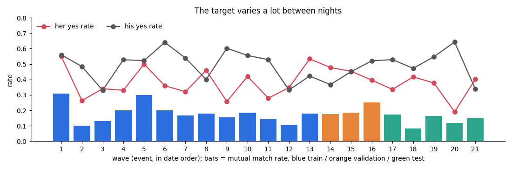
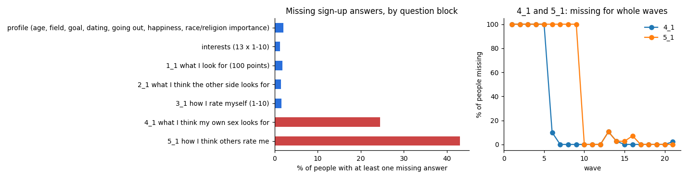
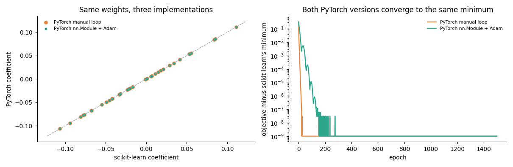
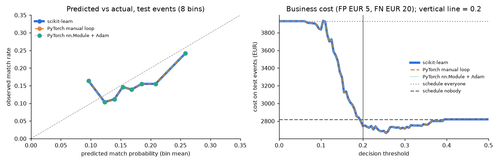
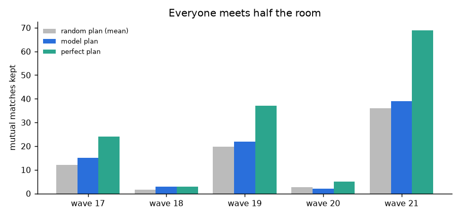
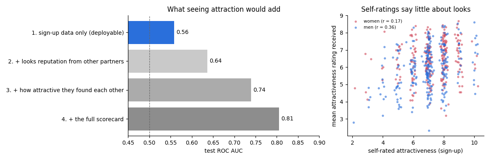
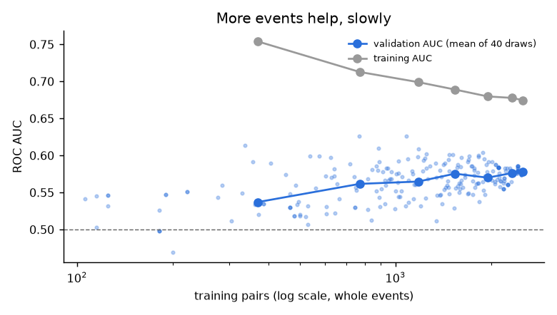

# Assignment 1 Report

- **Name**: Matias Arevalo
- **Student ID**:
- **Email**:
- **Group**: BBADBA 5A

## Dataset

I used the [Speed Dating Experiment dataset on Kaggle](https://www.kaggle.com/annavictoria/speed-dating-experiment/home), collected at Columbia Business School between October 2002 and April 2004. Fisman, Iyengar, Kamenica and Simonson used the experiment in their 2006 study, *Gender Differences in Mate Selection: Evidence from a Speed Dating Experiment*.

Participants completed a questionnaire before attending a speed-dating event, referred to as a “wave”. During the event, they met each participant of the opposite sex for four minutes. After each date, they recorded whether they wanted to meet the person again and rated them on six attributes. The dataset also includes follow-up questionnaires, so the timing of each variable matters.

The raw file contains **8,378 rows and 195 columns**, covering **551 participants**—274 women and 277 men—across **21 events**. Each row records a date from one participant's perspective. A complete date therefore appears twice, once from each side.

The pipeline in `train.py`, supported by the `speeddating/` package, starts from the raw CSV. It joins the two records of each date using the participant and partner IDs, producing **4,184 woman–man pairs**. Ten records have no partner ID and cannot be paired. The supplementary notebook, `assignment1_matias_arevalo.ipynb`, presents the workflow in one file.

I chose this dataset because it requires more than fitting a model to a ready-made table. A mutual match combines two decisions recorded in separate rows. Many promising predictors are only available after the date, so they cannot support a decision made beforehand. The repeated appearances of participants also make a random row split inappropriate for the intended use case.

## Business / real-life framing

### Client and decision

The hypothetical client organises speed-dating events. In a full rotation, everyone meets everyone on the other side of the room. With 22 participants per side, each person has 22 four-minute dates plus changeovers, taking close to two hours.

The organiser wants to run shorter events, or accommodate larger groups, where each person meets only some of the other participants. The decision is made before the event: **which pairs should meet?** At that point, the organiser has the sign-up surveys and guest list. The model estimates the probability that both members of each possible pair will say yes.

### How the use case shapes the pipeline

**Target.** A match requires two yeses: `dec_W * dec_M`. This equals 1 for 16.5% of the paired observations. The pipeline checks that this product agrees with the raw `match` column for every pair. A one-sided yes does not produce the mutual outcome the organiser wants.

**Inputs.** The deployed model uses information available before the event. Ratings of the partner's attractiveness, sincerity, intelligence, fun, ambition, shared interests and likeability are collected during the date. Using them would give the model information unavailable when the organiser makes the seating decision. They are excluded from the deployed model and used only in the separate attraction analysis.

**Split.** Whole events are assigned to training, validation or test in date order:

| Split | Waves | Pairs | Mutual matches |
| --- | --- | ---: | ---: |
| Training | 1–13 | 2,507 | 411 |
| Validation | 14–16 | 750 | 138 |
| Test | 17–21 | 927 | 141 |

The final model is fitted on the 16 development events—training plus validation—and evaluated on the five later test events. No participant appears in both development and test data.

A random row split would let the same participants appear in training and evaluation. On the development data, five-fold cross-validation gives an AUC of 0.628 with randomly split rows and 0.599 with whole events held out. Every evaluation pair in the random split involves at least one participant already represented in training. Holding out events better reflects an upcoming night with new participants.

Chronology also matters because the experiment changed between waves. Waves 6–9 used a different preference scale, wave 12 restricted the number of yeses, and participants in waves 18–21 were asked to bring a book or magazine.

**Decision threshold.** Predicting “no match” for every test pair achieves 84.8% accuracy but gives the organiser no useful ranking. I therefore evaluate the two errors in business terms. My assumptions are:

- **False positive: EUR 5.** Seating a pair that does not match uses a four-minute slot for two people. A ticket of roughly EUR 25 for 10–12 dates makes EUR 2.50 per person a reasonable working estimate.
- **False negative: EUR 20.** Failing to seat a pair that would have matched represents a missed opportunity to deliver the outcome participants paid for, and potentially a lost repeat visit.

These are hypothetical costs, not observed financial losses. With a predicted match probability `p`, seating the pair has expected error cost `5 × (1 − p)`; not seating it has expected error cost `20 × p`. The two are equal at:

```text
threshold = cost_FP / (cost_FP + cost_FN)
          = 5 / (5 + 20)
          = 0.20
```

The dashboard schedules pairs at or above this threshold. This rule depends on reasonably calibrated probabilities, which is why log loss guides the choice of regularisation. Both costs can be changed in the dashboard.

**Seating-plan evaluation.** A threshold treats pairs independently, while an event limits how many dates each person can attend. I therefore also simulate plans where each participant can meet up to 30%, 50% or 70% of the other side, rounded up to a whole number of dates. A linear program maximises the sum of predicted match probabilities under those individual limits. I compare the matches retained with random plans using the same limits and with a plan that has perfect knowledge of the outcomes.



## Data preparation & feature engineering

### Cleaning decisions

The pipeline runs and logs the raw-data checks behind the following decisions:

- **Drop survey blocks `4_1` and `5_1`.** Block `4_1`, about what participants think their own sex values, was not asked in waves 1–5. Block `5_1`, about how participants believe others rate them, was not asked in waves 1–9. Using these blocks would require imputing entire sets of answers for the earliest events. The other sign-up blocks have at least one missing answer for 2% of participants or fewer.
- **Impute inside the training pipeline.** Missing values remain missing until a median imputer fills them. The imputer and scaler are fitted only on the rows used for training, including within each cross-validation fold.
- **Flag missing core survey answers.** Seven participants—five women and two men—have missing answers identified by the `survey_missing` flag. Their values are imputed, while the indicator preserves information about the missingness.
- **Drop `art` from the interests.** Its correlation with `museums` is 0.87 when measured once per participant, the only interest pair above 0.8. Removing it reduces the duplication of this taste in the pair-level interest summaries.
- **Normalise preference weights.** The six “what do you look for?” answers are rescaled to sum to 100 for each person. Waves 6–9 originally used ratings from 1 to 10, which the published file already converts into shares. Some participants' totals still range from 90 to 148. Normalisation makes the weights comparable, and keeping decimals avoids introducing rounding distortions.
- **Define event size consistently.** The women's `round` value gives the number of men at an event, which is also the number of partners each woman meets. The men's corresponding value differs when the two sides are unequal.



### The 40 pre-event features

Each observation is a pair. The features describe the individuals, the relationship between their answers, or the event:

| Feature group | Number | Contents |
| --- | ---: | --- |
| Profile | 28 | Fourteen features for each participant: age, dating frequency, going-out frequency, expected happiness, three goal indicators, five self-ratings, preference weight on looks and a missing-survey flag |
| Pair | 11 | Preference fit in each direction, interest correlation and gap, signed and absolute age gap, same field, self-rated looks gap, same race and two race-preference interactions |
| Event | 1 | Number of men attending |

Dating and going-out frequency retain their ordinal scale, from 1 for several times a week to 7 for almost never. The goal codes are categories, so I use indicators for a serious relationship, getting a date and a fun night out, with the remaining goals as the reference category.

The main pair features are:

- **`pref_fit_W` and `pref_fit_M`:** the partner's self-ratings weighted by what the participant says they value. For example, a woman who places substantial weight on intelligence receives a higher fit score with a man who rates his intelligence highly.
- **`interest_corr` and `interest_gap`:** correlation measures whether the two people's 12 interest profiles have a similar pattern; mean absolute difference measures how far apart their ratings are.
- **`age_gap`, `age_gap_abs`, `same_field` and `looks_gap`:** differences or similarities that describe the combination rather than either participant alone.
- **`same_race` and `race_mismatch_W/M`:** a same-race indicator and the interaction `(1 − same_race) × importance of same race`. The interaction lets the effect of a mismatch depend on the participant's stated preference. I do not include separate ethnicity-category codes.

### Does each feature group earn its place?

I remove one group at a time and evaluate the same model and regularisation strength using leave-one-event-out cross-validation on the 16 development events.

| Setting | Features | Log loss | AUC | Mean within-event AUC |
| --- | ---: | ---: | ---: | ---: |
| All features | 40 | 0.4456 | 0.602 | 0.594 |
| Without profile features | 12 | 0.4490 | 0.575 | 0.580 |
| Without pair features | 29 | 0.4484 | 0.585 | 0.574 |
| Without event size | 39 | 0.4456 | 0.603 | 0.594 |

Removing the pair features produces the largest fall in within-event AUC, the ranking that matters for seating decisions. Event size makes no measurable improvement at this precision. I retained it because the organiser controls it and regularisation limits its coefficient.

### Features tried and dropped

I also tested four additional groups, using the same development events and scoring method. Each increased log loss, so none entered the final model.

| Group added | Total features | Log loss | AUC | Mean within-event AUC |
| --- | ---: | ---: | ---: | ---: |
| Raw interest levels: 12 per participant | 64 | 0.4487 | 0.586 | 0.586 |
| All six preference weights per participant | 50 | 0.4470 | 0.595 | 0.598 |
| Field of study: six groups per participant | 52 | 0.4506 | 0.585 | 0.584 |
| Beliefs about what the other side wants | 52 | 0.4463 | 0.601 | 0.590 |

The raw interests add 24 individual-level columns without improving validation performance. The two pair summaries, `interest_corr` and `interest_gap`, provide a more compact representation of the same answers. With only 549 matches in the development data, the extra columns appear to add more noise than useful signal.

## Modelling: three implementations, one model

### Model and shared objective

The target is binary and the decision rule requires probabilities, so I use logistic regression with an L2 penalty. All three implementations minimise the same objective on the same standardised features:

```text
J(w, b) = mean binary cross-entropy + (lambda / 2) × ||w||²
lambda  = 1 / (C × n)
```

Here, `n` is the number of fitting rows. Scikit-learn's equivalent formulation is `C × sum(losses) + ||w||² / 2`; dividing by `C × n` gives the objective above.

The intercept is unpenalised in all three implementations. In PyTorch, the penalty is added explicitly to the weights. Applying one optimiser `weight_decay` setting to all parameters would penalise the bias as well and break the comparison.

### Regularisation strength

I chose `C` using leave-one-event-out log loss on the 16 development events. A single validation split with three events was too small to give a stable choice.

| C | Development cross-validation log loss |
| ---: | ---: |
| 0.0003 | 0.4500 |
| 0.001 | 0.4465 |
| **0.003** | **0.4456** |
| 0.01 | 0.4476 |
| 0.03 | 0.4500 |
| 0.1 | 0.4517 |
| 1 | 0.4525 |

The selected value, **`C = 0.003`**, applies strong regularisation: `lambda` is approximately 0.1 for the final fit. This is consistent with a weak signal and limited positive examples relative to the number of features.

### PyTorch learning rates and convergence

Both PyTorch implementations were fitted on waves 1–13 for 1,500 full-batch epochs. I selected the learning rate that reached the lowest final training objective without divergence, and reported validation log loss alongside it.

The purpose was to reach the same solution as scikit-learn. Selecting the learning rate solely by validation loss could favour incomplete optimisation, effectively adding regularisation beyond the shared L2 penalty. This happened at a manual-loop learning rate of 0.01: its validation log loss was 0.4731, compared with 0.4757 for converged fits, but it had not reached the training minimum. A rate of 4.0 diverged.

The standard `nn.Module` implementation uses Adam with a cosine schedule that gradually reduces the learning rate to zero. In an earlier Colab run with a constant rate, Adam finished roughly `7 × 10⁻⁷` above the minimum, with coefficient differences of up to 0.002 and one different test decision. Adam's adaptive updates can continue oscillating near the minimum; reducing the step size helped it settle.

With the schedule, initial rates of 0.05 and 0.1 reached within `10⁻¹⁴` of scikit-learn's training objective. A rate of 0.01 stopped about `10⁻⁹` above it, while 0.001 remained approximately 0.09 above it. The selected rates were **2.0 for the manual loop** and **0.1 for Adam**.

### Final fit and test results

All three models were refitted on the same 3,257 development pairs, with shared preprocessing, `C` and objective. They were then evaluated on the same 927 test pairs, including 141 mutual matches. Business costs below use EUR 5 for a false positive, EUR 20 for a false negative and a threshold of 0.20.

| Model | ROC AUC | Mean within-event AUC | Average precision | Log loss | Brier score | Cost at t = 0.20 |
| --- | ---: | ---: | ---: | ---: | ---: | ---: |
| Scikit-learn `LogisticRegression`, L-BFGS | 0.558 | 0.572 | 0.226 | 0.4246 | 0.1281 | EUR 2,745 |
| PyTorch manual loop, gradient descent | 0.558 | 0.572 | 0.226 | 0.4246 | 0.1281 | EUR 2,745 |
| PyTorch `nn.Module` with Adam | 0.558 | 0.572 | 0.226 | 0.4246 | 0.1281 | EUR 2,745 |
| Baseline: development match rate for every pair; seat nobody | 0.500 | n/a | 0.152 | 0.4273 | 0.1292 | EUR 2,820 |
| Baseline: seat everyone | 0.500 | n/a | 0.152 | n/a | n/a | EUR 3,930 |

Average precision is calculated with `average_precision_score`; the dashboard labels this PR AUC. The seat-everyone baseline is included as a decision policy, so its log loss and Brier score are omitted here.

### Agreement between the implementations

The models agree closely. Maximum coefficient differences from scikit-learn are `7.2 × 10⁻⁸` for the manual loop and `6.9 × 10⁻⁸` for `nn.Module`. Across the three comparisons, intercept differences are below `2.1 × 10⁻⁷` and test-probability differences below `1.4 × 10⁻⁷`. **All 927 scheduling decisions are identical.**

The final training objective is **0.43813989** for all three. This supports the comparison: the implementations optimise the same regularised convex objective and reach effectively the same solution. The remaining differences are numerical, including float32 precision in PyTorch, float64 in scikit-learn and different optimisation procedures. In the checked run, fitting took about 0.01 seconds for scikit-learn and under a second for each PyTorch version; these timings depend on the machine.



### What the results mean for the organiser

The predictive signal is weak. Test ROC AUC is 0.558, with a pair-level bootstrap 95% interval of 0.508–0.614. Ranking within each woman's list of partners performs better, with mean AUC 0.612, than ranking within each man's list, at 0.535.

Strong regularisation compresses the probabilities: calibration-bin means range from approximately 0.10 to 0.26. Predicted and observed rates are broadly close, although the lowest bin underpredicts matches—about 0.10 predicted against 0.16 observed. The validation cost minimum is at a threshold of 0.165, reasonably close to the assumed-cost threshold of 0.20.

At 0.20, the model schedules **205 of 927 test pairs**, retaining **44 of 141 matches**. Its cost is EUR 2,745, compared with EUR 2,820 for seating nobody and EUR 3,930 for seating everyone. The observed saving over the better baseline is **EUR 75, or 2.7%**, across five events. That is a small difference on a limited test sample.

The result also depends on the cost assumptions. Increasing the false-negative cost to EUR 40 lowers the threshold to about 0.11. At that setting, seating everyone costs EUR 3,930, less than the model's EUR 4,260. The model therefore does not consistently improve on simple policies across plausible cost ratios.



The seating simulation shows a clearer advantage when the number of dates is restricted:

| Share of the other side allowed | Model matches retained | Random-plan mean | Perfect-foresight plan | Random plans at least as good as the model |
| --- | ---: | ---: | ---: | ---: |
| 30% | 57 | 45 | 125 | 1% |
| 50% | 81 | 72 | 138 | 5% |
| 70% | 108 | 102 | 141 | 12% |

At the 50% limit, random plans retain 72 matches on average, with a standard deviation of 4.9 across 200 draws. The model retains 81. Across the three settings, the gain over the random-plan mean is roughly 6–12 matches over five events. The much larger gap to perfect foresight shows how much uncertainty remains.



The standardised coefficients associate higher match probabilities with men who rate themselves as fun and report going out or dating more often. Older men and larger age gaps are associated with lower probabilities. Other positive associations include women's expected happiness, a shared field of study and a man's fit with the woman's stated preferences. Race mismatch combined with greater importance placed on same race has a negative association on both sides. These are model associations, not evidence that changing an attribute would cause a match.

## Limitations & next steps

### Physical attraction is largely missing from the sign-up data

The sign-up form provides self-rated attractiveness, but not how attractive two participants find each other. The following results show the size of that information gap:

1. Self-rated attractiveness correlates only **0.29** with average attractiveness ratings received during the event: 0.17 for women and 0.36 for men.
2. Average received attractiveness correlates **0.79** with the proportion of partners who say yes to that person.
3. His yes correlates 0.075 with her self-rated looks and 0.516 with his rating of her attractiveness. For her yes, the corresponding correlations are 0.088 and 0.445.
4. Using the sign-up features to predict each side's decision separately gives test AUC **0.654 for her yes** and **0.526 for his yes**. This is consistent with Fisman et al.'s finding that men respond more to physical attractiveness. A mutual match requires both decisions, so the less predictable side limits the combined outcome.

I also added attraction information in stages, retuning `C` on the development events for each variant and evaluating on the same test events:

| Information available | Test ROC AUC | Matches retained with the 50% limit |
| --- | ---: | ---: |
| Sign-up data only: deployed model | 0.558 | 81 |
| Plus average attractiveness ratings from other partners that night | 0.636 | 81 |
| Plus the two participants' ratings of each other's attractiveness | 0.739 | 111 |
| Plus the full scorecard | 0.805 | 115 |

The last three rows use information collected during the event. They are diagnostic comparisons, not models the organiser could use beforehand. The general attractiveness measure excludes the current partner's rating, but it still uses ratings from the same night.

Adding this “looks reputation” improves overall AUC without retaining more matches in the restricted seating plan. It captures general popularity, whereas the seating limits restrict how many dates each person can receive. Adding the pair's own attraction ratings has a much larger effect on the plan, increasing retained matches from 81 to 111.

This distinction is consistent with Joel, Eastwick and Finkel's 2017 study. Their pre-date questionnaires predicted general tendencies to desire others and to be desired, but not the additional attraction between particular pairs.



My next step would be to test pre-event attractiveness information, such as photo ratings or ratings from earlier events, alongside mutual-preference features. The reputation result suggests that a general popularity score alone may be insufficient; the useful information needs to help distinguish particular pairs.

### The effective sample is much smaller than the row count

The 8,378 raw rows become 4,184 pairs, but they represent only 551 people and 21 events. Each participant appears in roughly 15 pairs, so the observations are not independent.

- **Limited positive examples.** There are 690 matches overall and 549 in the development data: about 13.7 matches per feature. This is a rough indication of how much information supports the 40-feature model, rather than a firm limit on the permissible number of features. The strong selected penalty and poorer performance of the additional feature groups both point to limited signal.
- **Uncertain test estimates.** The test set contains 927 pairs but only five events. The bootstrap resamples pairs independently, so its AUC interval is likely optimistic because it does not preserve participant and event dependence. Small differences between models, and the EUR 75 saving, should therefore be interpreted cautiously.
- **Slow gains from more data.** The learning curve uses random subsets of 2–13 training events and evaluates on the three validation events. There are 40 draws for each size below 13 events, and one fit using all 13. Mean validation AUC rises from 0.537 with two events to 0.578 with 13. From six events upwards, the estimated gain is about 0.01 per doubling of the number of training pairs. Extrapolating that trend from around 0.58 to 0.65 would require roughly two orders of magnitude more events. That is an uncertain extrapolation, but it suggests that more of the same questionnaire data would not quickly close the attraction gap.
- **Limited transferability.** The sample covers students at one university in 2002–2004 and woman–man dates. These results do not establish performance in other cities, age groups or same-sex events.



### Other limitations

- The EUR 5 and EUR 20 error costs are assumptions. The dashboard makes their effect visible, but real deployment would require costs grounded in the organiser's own operations.
- The experimental conditions changed between waves. With more time, I would test indicators for those conditions, while recognising that some apply to only one or a few events.
- Survey answers are self-reported, and stated preferences may differ from choices made during an actual date.
- The seating simulation imposes individual date limits and assumes that changing the schedule does not change the outcome of a date. It does not model order, fatigue or the influence of other partners met that night.

## Generative AI use disclosure

I used **Claude (Anthropic)** to produce the core Python code through an iterative prompting process. This included data preparation, feature construction, the three implementations of logistic regression, evaluation and the Gradio dashboard. I provided the prompts, context and requests for revisions that guided this coding work.

I researched the original dataset and study, selected the dataset, and developed the business use case. I carried out the analysis and interpretation of the results and developed the conclusions presented in this report. Claude's main contribution was implementing the code needed to carry out that work.

I also used **ChatGPT (OpenAI)** to check and package the repository, convert the dashboard into `app.ipynb`, and refine the report's wording and Markdown formatting.

## References

- **Dataset:** [Speed Dating Experiment, Kaggle](https://www.kaggle.com/annavictoria/speed-dating-experiment/home), including `Speed Dating Data.csv` and its data key.
- **Original study:** Fisman, R., Iyengar, S. S., Kamenica, E., & Simonson, I. (2006). [Gender Differences in Mate Selection: Evidence from a Speed Dating Experiment](https://business.columbia.edu/faculty/research/gender-differences-mate-selection-evidence-speed-dating-experiment). *The Quarterly Journal of Economics, 121*(2), 673–697.
- **Related study:** Joel, S., Eastwick, P. W., & Finkel, E. J. (2017). [Is Romantic Desire Predictable? Machine Learning Applied to Initial Romantic Attraction](https://www.psychologicalscience.org/journals/psychological-science/0956797617714580/). *Psychological Science, 28*(10), 1478–1489. https://doi.org/10.1177/0956797617714580
